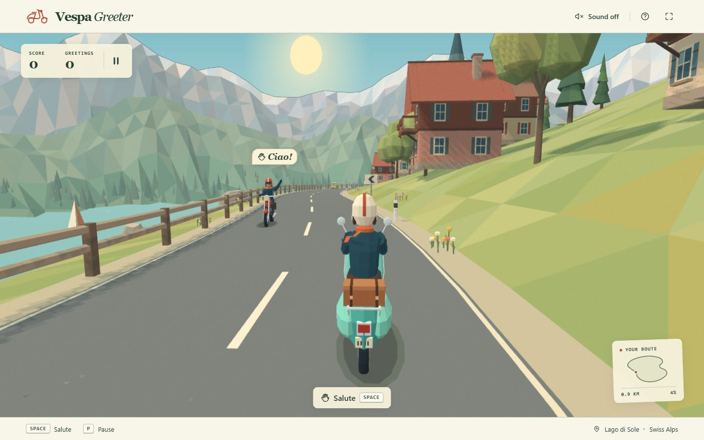

# Ciao, Vespa!

[Play the ChatGPT edition](https://iago-swi.github.io/vespa-greeter/chatgpt/), or open `index.html` locally. The game runs offline without a build step.

The Vespa steers itself around an Alpine lake. Press **Space** to return a motorcyclist’s wave before you pass and earn 10 points. An uninvited salute costs 5 points. Press **P** to pause, or use the on-screen controls.
