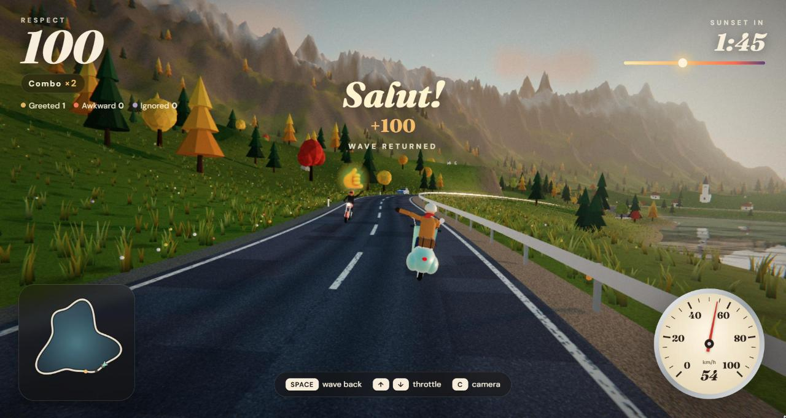

# Vespa Greeter — Claude version

A small 3D browser game built with Claude (Anthropic), using Three.js. Everything is
procedural: the game uses no image, model or sound files, only `index.html` and `game.js`.

**[Play it in your browser](https://iago-swi.github.io/vespa-greeter/claude/)**

## Run it

The game loads as a JavaScript module, so it needs a local web server (opening
`index.html` straight from the file system will not work).

- **Windows:** double-click `start.bat` (needs Python), or
- **Any system:** run `python -m http.server 5173` in this folder and open
  <http://localhost:5173>.

Three.js and the fonts load from a CDN, so an internet connection is needed.

## How to play

You ride a vintage scooter around a lakeside loop for three minutes while the sun sets.
Steering is automatic.

| Key | Action |
| --- | --- |
| `SPACE` | Wave |
| `↑` / `↓` | Throttle |
| `C` | Change camera |
| `M` | Sound on/off |
| `P` | Pause |

| Event | Points |
| --- | --- |
| Return a motorcyclist's wave (faster is worth more, streaks multiply up to ×5) | +100 to +160 |
| Wave at a rider who did not wave, or at a car, lorry, bus or cyclist | −50 |
| Wave before the rider has signalled | −40 |
| Leave a waving rider hanging | −30 |
| Wave at nobody | −10 |
