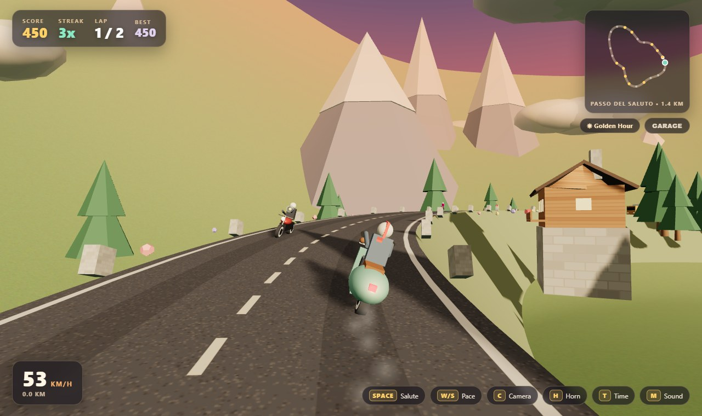

# Vespa Greeter — Passo del Saluto (Gemini version)

A 3D Alpine pass browser game built with Gemini (Google), using a locally bundled Three.js r128 build and Web Audio synthesis for 100% offline play.

**[Play the Gemini edition](https://iago-swi.github.io/vespa-greeter/gemini/)**

## Highlights

- **Offline-ready**: Open `index.html` directly or double-click `Play Vespa Greeter.bat` on Windows — no build step or internet connection needed.
- **Real-time Vespa Garage**: Choose between Vintage Mint, Rosso Corsa, Cream White, and Alpine Blue on the start screen.
- **Time-of-Day Atmosphere**: Switch live between Golden Hour, Crisp Alpine Morning, and Twilight (with working headlights and warm stone-tunnel lighting).
- **Alpine Pass Scenery**: Roadside kilometer markers, Passo del Saluto summit arch, wooden chalets, stone mountain refuges, road-dust particles, and optical sun lens flare.
- **Two Modes & Local High Scores**: Separate Top-5 `localStorage` leaderboards for **2-Lap Scenic Tour** and **Endless Cruise**.
- **2-Stroke Vespa Audio**: Acceleration/deceleration pitch dynamics, exhaust decel pops, passing Doppler whoosh, and a classic scooter horn (`H`).

## Controls

| Key | Action |
| --- | --- |
| `SPACE` | Salute oncoming motorbike riders |
| `W` / `S` or `↑` / `↓` | Accelerate / decelerate |
| `A` / `D` or `←` / `→` | Gentle lane nudge |
| `C` | Toggle camera (Chase View / First-Person Handlebars View) |
| `H` | Classic Vespa horn beep |
| `T` | Cycle Time of Day / Atmosphere |
| `M` | Mute / unmute sound |
| `ESC` | Finish & save score (Endless Cruise) or return to Garage |

## Scoring

| Event | Points |
| --- | --- |
| Return a saluting motorcyclist's wave before they pass (streak multiplier up to `3x`) | `+100` to `+150` × multiplier |
| Salute a non-saluting rider, car, truck, cyclist, or empty road | `−50` (resets streak) |

See [README.txt](README.txt) for Windows launch notes.
